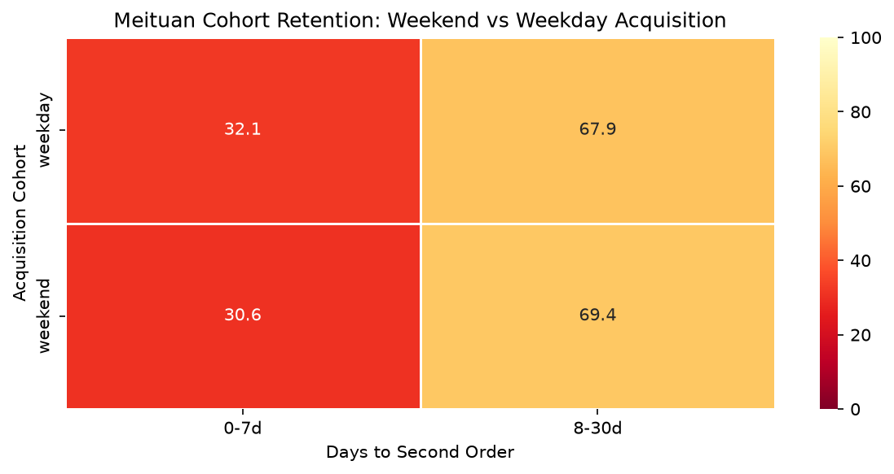

# O2O Business User Cohort Analysis & Retention Matrix Prototype

I built a user retention analysis project built for Meituan's Prototype User Operations 
context. I used the Instacart 2017 grocery dataset as a proxy for O2O food delivery behavior.

## Background

User acquisition cost on O2O platforms is high. If a new user orders once and never returns, the company loses money on every marketing dollar spent acquiring them. The question is can we predict retention behavior from day one, based on when and how a user first engaged

## What This Project Does

Takes raw order history data and answers one core question:

> Do users who place their first order on a weekend behave differently 
> from users who first order on a weekday and how fast do they come back?

## What I Found

<p align="center">
  
  
</p>

**Reorder speed:**
- 32% of weekday users reorder within 7 days
- 30.6% of weekend users reorder within 7 days
- Both groups have a strong day-30 reorder spike monthly habit users

**When users come back:**
- Weekday cohort returns most on Mondays
- Weekend cohort returns most on Sundays
- People tend to reorder on the same type of day they first ordered

**Two types of users exist in both cohorts:**
- Weekly habit users, reorder around day 7
- Monthly habit users, reorder around day 30

## Business Recommendations

1. Sending retention coupons on day 6 and day 28 right before the natural reorder window is a better practice
2. Scheduling Monday push campaigns for weekday cohort users
3. Scheduling Sunday push campaigns for weekend cohort users
4. Weekday acquisition channels produce slightly faster, returning users worth increasing budget allocation there

## Stack

- Python, Pandas, NumPy — data processing
- Seaborn, Matplotlib — visualization
- JupyterLab — analysis environment
- Anaconda — environment management

## Dataset

Instacart Online Grocery Shopping Dataset 2017  
Source: https://www.kaggle.com/competitions/instacart-market-basket-analysis/data  
3.4M orders, 206K users

## Project Structure

```text
meituan-cohort-retention/
├── data/
│   └── raw/
│       └── orders.csv
├── notebooks/
│   ├── 01_EDA_Load_data.ipynb
│   ├── cohort_analysis.ipynb
│   └── insights_heatmap.ipynb
└── outputs/
    ├── retention_heatmap.png
    └── retention_linegraph.png
```


## How to Run
```
conda create -n meituan-cohort python=3.11
conda activate meituan-cohort
conda install pandas numpy seaborn matplotlib scipy jupyterlab -y
jupyter lab
```
## Future Goals

This project is actively being improved. Next steps planned:

**1. RFM Segmentation**  
Group users into segments like ALL Time Users, Regular Users, At-Risk Low visiting Users, and Lost 
based on three factors how recently they ordered, how often they 
order, and how many total orders they have placed. This gives a cleaner targeting list instead of treating all users the same.

**2. Churn Prediction Flag**  
Label any user who has not placed an order in 30 or more days as churned. 
Then build a simple model to identify which early signals (order gap, 
first order day, reorder speed) predict churn before it happens. 
This lets User Ops intervene early with a re-engagement coupon before 
the user is fully lost.

Both additions will be built on top of the existing pipeline with no 
change to the current notebook structure.

